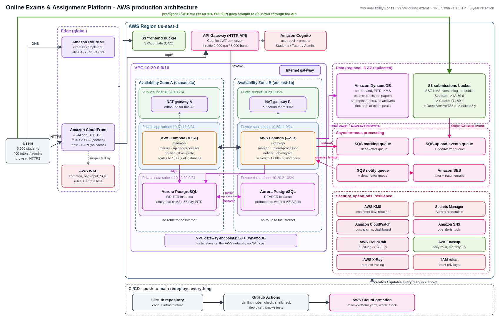

# DSO303 Assignment 2: Online Exams and Assignment Platform

A university with 8,000 students and 400 staff moves exams and assignment submissions online. This repository holds the AWS production design, the documentation for every service, and a deployment that is **fully reproducible from code**.



## Summary

| Requirement | How it is met |
|---|---|
| Role-based sign-in | Amazon Cognito user pool, groups `Students` / `Tutors` / `Admins`; JWT checked on every API call |
| Timed MCQ + short-answer exams, autosave every 30 s | SPA timer driven by a server-side `endsAt`; `PUT /autosave` makes a conditional write to DynamoDB |
| Auto-marking of MCQs | Submit → SQS `marking` → `marker` Lambda → result in Aurora |
| PDF/ZIP uploads up to 50 MB | Presigned S3 POST (type, 1 B–50 MB and SSE-KMS enforced by S3 itself); files never pass through the API |
| Email when results are released / tutor notified on upload | SQS `notify` → `notifier` Lambda → Amazon SES |
| 300–500 users normally, 3,000 starts in 5 min | CloudFront, API Gateway throttles, Lambda + scheduled provisioned concurrency, DynamoDB on-demand hot path, SQS buffering |
| 99.9 %, survives loss of one AZ | Every VPC tier in two AZs; NAT per AZ; Aurora writer AZ-a + reader AZ-b; regional multi-AZ managed services |
| RPO ≤ 5 min, RTO ≤ 1 h | Autosaves synchronously replicated (RPO ≈ 0); DynamoDB PITR; Aurora 35-day PITR, failover < 60 s |
| Records kept 5 years | S3 lifecycle (IA → Glacier IR → Deep Archive → delete at 1,830 d); AWS Backup monthly copies for 5 years; CloudTrail logs 5 years |
| Encryption in transit and at rest | TLS 1.2+ at CloudFront, TLS-only bucket policy; one KMS key (rotation on) for Aurora, DynamoDB, S3, SQS, Secrets Manager, Backup |

## Repository layout

| Path | Contents |
|---|---|
| [architecture/](architecture/) | [Diagram](architecture/architecture.png), [walkthroughs](architecture/walkthroughs.md) with sequence diagrams, [peak and AZ-loss explanation](architecture/peak-and-az-failure.md) (289 words) |
| [docs/services.md](docs/services.md) | Every service: role, why it beats the alternative, configuration, connections |
| [infra/cloudformation/exam-platform.yaml](infra/cloudformation/exam-platform.yaml) | The whole platform as one CloudFormation template (98 resources, `cfn-lint` clean) |
| [infra/floci/docker-compose.yml](infra/floci/docker-compose.yml) | Local AWS emulator (Floci 2.5.0) used for the implementation |
| [infra/fis/az-a-outage.json](infra/fis/az-a-outage.json) | AWS Fault Injection Service experiment for the AZ-loss drill on real AWS |
| [app/functions/](app/functions/) | Lambda code: `api.mjs` (HTTP API), `workers.mjs` (marker, upload-processor, notifier), `migrate.mjs` |
| [app/frontend/](app/frontend/) | Single-page web app (no build step) |
| [scripts/](scripts/) | `deploy.sh`, `teardown.sh`, `smoke-test.sh`, `verify-infra.sh`, `simulate-walkthrough1.sh`, `simulate-walkthrough2.sh`, `simulate-az-failure.sh` |
| [.github/workflows/deploy.yml](.github/workflows/deploy.yml) | CI/CD: push to `main` → validate → deploy → smoke test |
| [screenshots/](screenshots/) | Evidence from the working deployment and the CI/CD run (10 images) |
| [evidence/](evidence/) | Cloud Architecture Lab screenshots (6 images) and the lab files in [evidence/lab-json/](evidence/lab-json/) (see [Cloud Architecture Lab](#cloud-architecture-lab) below) |
| [report/README.md](report/README.md) | Assignment report |

## Deploy

### Prerequisites

Docker, the AWS CLI v2, Node.js 20 or newer, and Python 3. For the emulator, add this profile to `~/.aws/config` (any dummy keys work; put them in `~/.aws/credentials`):

```ini
[profile floci]
region = us-east-1
endpoint_url = http://localhost:4566
```

### On the local emulator (what the evidence was produced with)

```bash
./scripts/floci-up.sh                 # start Floci (Lambda and Aurora run as Docker containers)
export AWS_PROFILE=floci
./scripts/deploy.sh                   # build bundle -> CloudFormation -> migrate -> seed -> publish SPA
./scripts/smoke-test.sh               # 6 post-deploy checks
```

Open the printed frontend URL (`http://localhost:4566/exams-prod-frontend-000000000000/index.html`) and sign in as `student1`, `student2`, `tutor1` or `admin1` with password `Exam-Demo-2026!`.

### On a real AWS account

```bash
export AWS_PROFILE=<your-profile> PLATFORM=aws
./scripts/deploy.sh
```

Before the first real deploy, delegate the Route 53 zone's NS records for `DomainName` (default `exams.example.edu`), so ACM can validate the certificate, and verify the SES sender. `Platform=aws` also enables Aurora deletion protection and API Gateway's Cognito JWT authorizer.

`deploy.sh` is idempotent. Every code change produces a new content-hashed Lambda bundle, so running it again deploys exactly what changed.

## Simulations (Task 3)

```bash
./scripts/verify-infra.sh            # read back tiers, AZs, encryption, retention, edge
./scripts/simulate-walkthrough1.sh   # student opens exam, 3 autosaves 30 s apart, crash-restore, submit -> auto-mark
./scripts/simulate-walkthrough2.sh   # 40 MB presigned upload -> S3 event -> Aurora -> SES email to tutor; 55 MB and .exe refused
./scripts/simulate-az-failure.sh     # lose us-east-1a mid-exam: Aurora failover + Lambda on AZ-b only, while traffic runs
```

## Cloud Architecture Lab

The same design is provided as five lab files. To load one, open the lab, click **Export → Upload JSON** and choose the file. Then run the simulation shown in the table.

| Lab file | Mode | What it shows | Screenshot |
|---|---|---|---|
| `lab-01-full-architecture.json` | Design | The full two-AZ build | `lab-01-full-architecture.png` |
| `lab-02-walkthrough1.json` | Simulate → **Send Request** | Walkthrough 1, HTTP 200 | `lab-02-walkthrough1-exam-autosave.png` |
| `lab-03a-walkthrough2-upload.json` | Simulate → **Send Request** | Walkthrough 2, part 1 (upload), HTTP 202 | `lab-03a-walkthrough2-upload.png` |
| `lab-03b-walkthrough2-notify.json` | Simulate → **Send Request** | Walkthrough 2, part 2 (tutor notified), HTTP 202 | `lab-03b-walkthrough2-tutor-notified.png` |
| `lab-04-az-failure.json` | Failure Lab (AZ-A outage already injected) → **Send Request**, then back to **Failure Lab** | AZ-A lost, request still HTTP 200 | `lab-04-az-failure.png`, `lab-04b-az-failure-request-via-azb.png` |

## Tear down

```bash
./scripts/teardown.sh                # empties versioned buckets, deletes the stack and the artifact bucket
./scripts/floci-down.sh --purge      # emulator only: stop Floci and wipe its state
```

On AWS, Aurora leaves a final snapshot (`DeletionPolicy: Snapshot`). Delete it by hand if it isn't needed.

## CI/CD

[.github/workflows/deploy.yml](.github/workflows/deploy.yml) runs on every push to `main`:

1. **validate** (GitHub-hosted runner): `cfn-lint`, `node --check`, `shellcheck`.
2. **deploy-emulator** (self-hosted runner labelled `floci`): `floci-up.sh` → `deploy.sh` → `smoke-test.sh`.
3. **deploy-aws** instead, when the repository variable `DEPLOY_TARGET=aws`: GitHub OIDC → `vars.AWS_DEPLOY_ROLE_ARN` → `deploy.sh` (no stored keys).

To turn it on for the emulator:

1. Push this folder to a GitHub repository.
2. On the machine running Docker, go to **Settings → Actions → Runners → New self-hosted runner** and follow GitHub's commands, adding the label `floci` when `config.sh` asks.
3. Make sure the runner's user has the `floci` AWS profile above.

## Emulator notes (honest limitations)

The implementation runs on **Floci 2.5.0**, a local AWS emulator. A few behaviours differ from AWS. Each one is handled in code and documented here:

| Behaviour on Floci | How it is handled |
|---|---|
| The API Gateway JWT authorizer rejects valid Cognito tokens | With `Platform=emulator` the route has no gateway authorizer, and the Lambda performs the same check: RS256 signature against the pool's JWKS, issuer, expiry and client ([lib.mjs](app/functions/src/lib.mjs)). Bad tokens get 401. |
| CloudFormation ignores DynamoDB SSE/PITR, KMS rotation, Aurora backup retention and the AWS Backup plan | [scripts/floci-reconcile.sh](scripts/floci-reconcile.sh) applies the same settings through the service APIs after every deploy |
| Aurora instances are reported in one AZ and share one Postgres container | The writer/reader roles, failover and DB subnet group (both AZs) are real API state. On AWS a failover causes about 30 s of connection errors, which the emulator does not reproduce. |
| CloudFront/WAF/Route 53 accept configuration but serve no traffic | Requests go to the API at `localhost:4566/restapis/...` and the SPA from the S3 path URL, on the same origin, as CloudFront's `/api/*` behaviour would do |
| FIS experiments do not run; Lambda scheduled concurrency is ECS-only | The AZ failure is injected with the equivalent RDS and Lambda API calls; the FIS template is provided for AWS |
