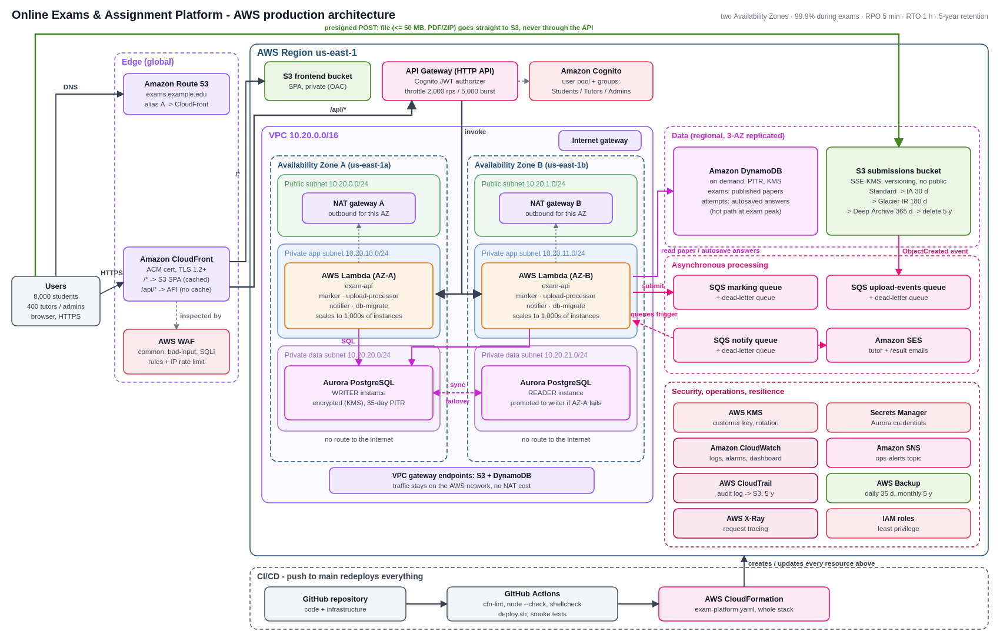
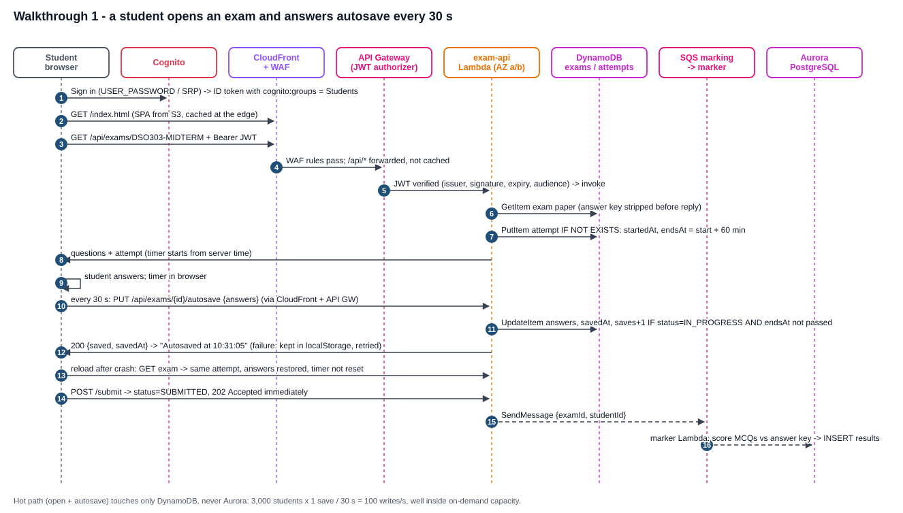
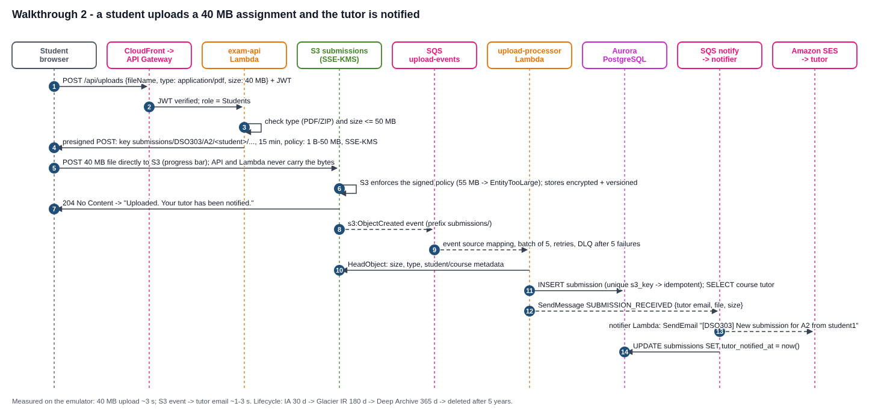

# Architecture and request walkthroughs

The diagram is generated from [build_diagram.py](build_diagram.py) (SVG: [architecture.svg](architecture.svg)). How the design handles the exam peak and the loss of an AZ is in [peak-and-az-failure.md](peak-and-az-failure.md).

## Tiers at a glance

| Tier | AZ-a (us-east-1a) | AZ-b (us-east-1b) | Regional / global |
|---|---|---|---|
| Edge | — | — | Route 53, CloudFront + ACM, AWS WAF |
| Public subnets | 10.20.0.0/24: NAT gateway A | 10.20.1.0/24: NAT gateway B | Internet gateway |
| Private app subnets | 10.20.10.0/24: Lambda ENIs | 10.20.11.0/24: Lambda ENIs | API Gateway, Cognito |
| Private data subnets (no internet route) | 10.20.20.0/24: Aurora writer | 10.20.21.0/24: Aurora reader (failover target) | DynamoDB, S3, SQS, SES |
| Operations | | | KMS, Secrets Manager, CloudWatch, X-Ray, SNS, CloudTrail, AWS Backup |
| Delivery | | | GitHub → GitHub Actions → CloudFormation |

## Walkthrough 1: a student opens an exam and answers autosave

1. The student signs in to **Cognito**. The ID token carries `cognito:groups = Students`.
2. The browser loads the SPA from **CloudFront**, which serves it from the private S3 frontend bucket.
3. `GET /api/exams/DSO303-MIDTERM` goes through **CloudFront + WAF** to **API Gateway**. API Gateway's **JWT authorizer** checks the token's issuer, signature, expiry and audience.
4. The **exam-api Lambda**, running in the private app subnets of both AZs:
   - reads the published paper from **DynamoDB** `exams` and strips the answer key;
   - creates the attempt in `attempts` with a conditional put (`startedAt`, `endsAt` = start + 60 min), so the timer comes from the server and cannot be reset.
5. Every 30 seconds the browser sends `PUT /api/exams/{id}/autosave`. The Lambda makes **one conditional DynamoDB update**: answers, `savedAt` and `saves + 1`, but only while the attempt is `IN_PROGRESS` and before `endsAt`. The browser shows "Autosaved at hh:mm:ss". If a save fails, the answers are kept in `localStorage` and retried on the next tick.
6. If the browser crashes, opening the exam again returns the same attempt with the saved answers and an unchanged deadline.
7. On submit, the API returns **202 Accepted** at once and puts a message on **SQS marking**. The **marker Lambda** scores the MCQs against the answer key and writes the result to **Aurora** (short answers wait for the tutor). When the tutor releases results, **SQS notify → notifier → SES** emails the students.

## Walkthrough 2: a student uploads a 40 MB assignment and the tutor is notified

1. The browser calls `POST /api/uploads` with the file name, type and size. **exam-api** checks the role (Students), the type (PDF or ZIP) and the size (≤ 50 MB).
2. It returns a **presigned S3 POST**, valid for 15 minutes, for the key `submissions/<course>/<assignment>/<student>/<time>-<file>`. The signed policy requires 1 B–50 MB, the exact content type and `aws:kms` encryption.
3. The browser uploads the 40 MB file **straight to S3**, showing a progress bar. API Gateway and Lambda never carry the bytes, which avoids API Gateway's 10 MB payload limit. S3 itself rejects anything outside the policy: a 55 MB file gets `EntityTooLarge`.
4. S3 stores the object encrypted with the platform KMS key and versioned. Lifecycle rules then move it Standard → Standard-IA (30 d) → Glacier Instant Retrieval (180 d) → Deep Archive (365 d), and delete it after 5 years.
5. The **S3 ObjectCreated** event goes to **SQS upload-events**, which triggers the **upload-processor Lambda**. It reads the object metadata and inserts the submission into **Aurora**; a unique `s3_key` makes a duplicate event harmless. It then looks up the course tutor and queues a message on **SQS notify**.
6. The **notifier Lambda** sends the tutor an email through **SES** ("[DSO303] New submission for A2 from student1", with file name and size) and records `tutor_notified_at`. Each queue has a dead-letter queue and a CloudWatch alarm, so a failed notification is never silently lost.
