## Assignment 2

**DSO303 - Cloud Native Solution Design** 
**Tutor: Mr. Norbu Tshering Lepcha**

**Submitted by** 
**Dechen Wangdra Sherpa**

**Student No: 02230281**

---

## Contents

1. [Introduction](#1-introduction)
2. [Task 1 – Architecture design](#2-task-1--architecture-design)
   - 2.1 [Production architecture](#21-production-architecture)
   - 2.2 [Walkthrough 1 – opening an exam and autosaving](#22-walkthrough-1--a-student-opens-an-exam-and-answers-autosave)
   - 2.3 [Walkthrough 2 – upload 40 MB and notify the tutor](#23-walkthrough-2--a-student-uploads-a-40-mb-assignment-and-the-tutor-is-notified)
   - 2.4 [Handling the exam peak and the loss of one AZ](#24-handling-the-exam-peak-and-the-loss-of-one-az-289-words)
3. [Task 2 – Service documentation](#3-task-2--service-documentation)
4. [Task 3 – Implementation](#4-task-3--implementation)
   - 4.1 [Approach](#41-approach)
   - 4.2 [Infrastructure deployed from code](#42-infrastructure-deployed-from-code)
   - 4.3 [Walkthrough 1 – opening an exam and autosaving](#43-walkthrough-1--opening-an-exam-and-autosaving)
   - 4.4 [Walkthrough 2 – uploading 40 MB and notifying the tutor](#44-walkthrough-2--uploading-40-mb-and-notifying-the-tutor)
   - 4.5 [Losing one Availability Zone](#45-losing-one-availability-zone)
   - 4.6 [Infrastructure as code and CI/CD](#46-infrastructure-as-code-and-cicd)
   - 4.7 [Cloud Architecture Lab build](#47-cloud-architecture-lab-build)
5. [Requirements traceability](#5-requirements-traceability)
6. [Conclusion](#6-conclusion)
7. [References](#references)

---

## 1. Introduction

A university with 8,000 students and about 400 staff wants to move all its exams and assignment submissions online. In this assignment I designed the cloud system for this on AWS (Task 1), explained why each AWS service was chosen (Task 2), and built and tested the system (Task 3).

The system has three types of users:

- **Students** sit timed exams and upload assignments.
- **Tutors** create exams, mark them and release the results.
- **Administrators** manage users and exam schedules.

The table below lists the main requirements and where each one is covered in this report.

| Requirement | What is needed | Where it is covered |
|---|---|---|
| Load | 300–500 users at once normally; 3,000 students starting one exam within 5 minutes | Section 2.4 |
| Availability | Online 99.9% of the time during exams, even if one Availability Zone fails | Sections 2.4 and 4.5, Figure 11 |
| Data loss and recovery | Lose at most 5 minutes of answers (RPO); be back within 1 hour (RTO) | Sections 2.4 and 4.5 |
| Record keeping | Keep all records for 5 years | Section 3 |
| Security | Sign-in based on role; data encrypted when sent and when stored | Sections 2.1 and 3, Figure 5 |
| File uploads | PDF or ZIP files up to 50 MB; the tutor is told about new uploads | Sections 2.3 and 4.4 |

All the code, diagrams and evidence are in the project repository: `README.md` (summary, deploy and tear-down steps), `architecture/` (diagrams and walkthroughs), `docs/services.md` (service table), `screenshots/` (deployment evidence) and `evidence/` (Cloud Architecture Lab images).

---

## 2. Task 1 – Architecture design

### 2.1 Production architecture

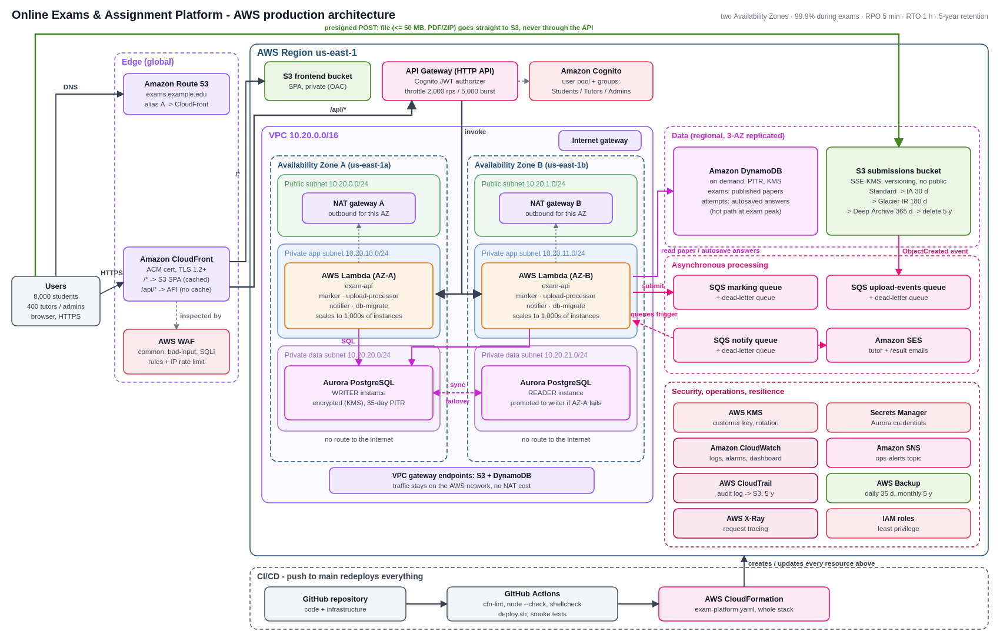

*Figure 1. The complete production architecture: one VPC with public, private-app and private-data subnets in two Availability Zones, the edge services, the regional AWS services and the CI/CD pipeline.*

Figure 1 shows the full design. It is easiest to read from left to right, following a student's request.

**Network.** Everything that needs a private network sits inside one **VPC** (Virtual Private Cloud, `10.20.0.0/16`). The VPC is split into three layers, and each layer is built twice, once in each **Availability Zone** (AZ). An AZ is a separate data centre, so if one AZ fails the copy in the other AZ keeps working.

- **Public subnets** (`10.20.0.0/24`, `10.20.1.0/24`) only hold a **NAT gateway** for each AZ. This lets the private parts reach the internet, but nothing on the internet can connect in.
- **Private app subnets** (`10.20.10.0/24`, `10.20.11.0/24`) are where the **Lambda** functions (the application code) run.
- **Private data subnets** (`10.20.20.0/24`, `10.20.21.0/24`) hold the **Aurora PostgreSQL** database: the main copy (writer) in AZ-a and a standby copy (reader) in AZ-b. These subnets have no route to the internet at all, and only the Lambda functions are allowed to connect to the database.

**Entry point (edge).** Users type `exams.example.edu`. **Route 53** (DNS) sends them to **CloudFront**, which delivers the website and passes API calls (`/api/...`) on to **API Gateway**. **AWS WAF** blocks common attacks, and an **ACM** certificate gives HTTPS.

**Sign-in.** **Amazon Cognito** stores the users in three groups: Students, Tutors and Admins. After signing in, each user gets a token, and API Gateway checks that token on every request.

**Data.**

- **Aurora PostgreSQL** keeps the main records: exams, results and submissions.
- **DynamoDB** holds the exam papers and the autosaved answers, because it handles very many small writes quickly.
- **S3** stores the uploaded assignment files. Older files move automatically to cheaper storage and are deleted after 5 years.

**Background work.** Jobs that do not need an instant answer go into **SQS** queues: marking, processing uploads and sending emails. Small Lambda functions handle these jobs, and **Amazon SES** sends the emails.

**Security and operations.** One **KMS** key encrypts all stored data. **Secrets Manager** keeps the database password. **CloudWatch** collects logs and raises alarms, **CloudTrail** records every action for auditing, and **AWS Backup** keeps copies for 5 years.

**Deployment (CI/CD).** The whole system is described in one **CloudFormation** template. When code is pushed to GitHub, **GitHub Actions** checks it and deploys it.

### 2.2 Walkthrough 1 – a student opens an exam and answers autosave

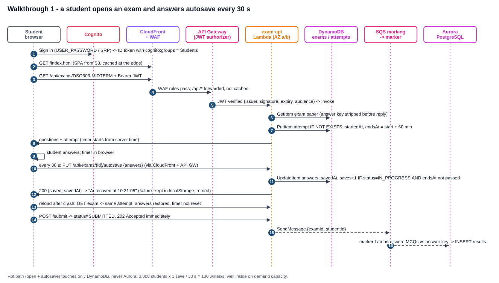

*Figure 2. Walkthrough 1: signing in, opening the exam, autosaving every 30 seconds, recovering after a crash, and marking.*

1. The student signs in with Cognito and receives a token that says they are in the Students group.
2. The browser loads the exam website from CloudFront, then asks for the exam (`GET /api/exams/DSO303-MIDTERM`). WAF checks the request, and API Gateway checks the token.
3. The `exam-api` Lambda reads the exam paper from DynamoDB and removes the answer key before sending it. It also records when the exam started and when it must end (start + 60 minutes). Because the server sets the end time, a student cannot get extra time by changing their computer clock.
4. Every 30 seconds the browser sends the current answers (`PUT .../autosave`). The Lambda saves them in DynamoDB, but only if the exam is still running and the time has not run out. The page then shows "Autosaved at hh:mm:ss". If a save fails, the answers are kept in the browser and sent again next time.
5. If the browser crashes, the student simply opens the exam again. Their saved answers come back and the timer continues from where it was.
6. When the student submits, the reply comes back straight away. The marking job goes into an SQS queue, the marker Lambda marks the multiple-choice questions, and the result is saved in Aurora. When the tutor releases the results, the students get an email through SES.

### 2.3 Walkthrough 2 – a student uploads a 40 MB assignment and the tutor is notified

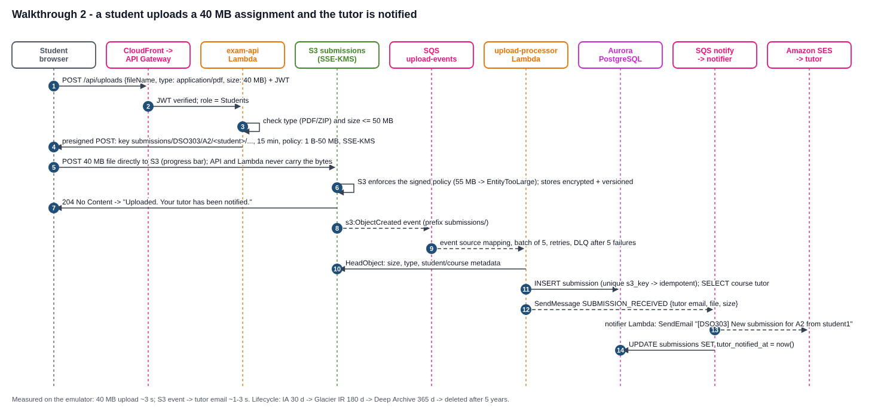

*Figure 3. Walkthrough 2: the file goes straight to S3, then S3 → SQS → Lambda → Aurora → SQS → SES sends an email to the tutor.*

1. The browser tells the API the file name, type and size. The `exam-api` Lambda checks that the user is a student, that the file is a PDF or ZIP, and that it is not larger than 50 MB.
2. The API replies with a **presigned upload link**. This is a temporary link (valid for 15 minutes) that allows exactly one upload to S3, only for files of 1 byte to 50 MB, and only with encryption.
3. The browser uploads the 40 MB file **directly to S3** using that link. The file never passes through API Gateway or Lambda. This matters because API Gateway cannot accept requests larger than 10 MB. S3 rejects any file that breaks the rules of the link.
4. When the file arrives, S3 puts a message in the `upload-events` SQS queue. The upload-processor Lambda reads it, saves the submission details in Aurora, and puts a message in the `notify` queue for the course tutor.
5. The notifier Lambda sends the tutor an email through SES and records the time it was sent. If sending fails, the message is kept in a separate "dead-letter" queue and an alarm is raised, so no notification is lost silently.

### 2.4 Handling the exam peak and the loss of one AZ (289 words)

**The exam peak.** When 3,000 students start an exam within 5 minutes, about 10 students open the exam every second. Then about 100 autosaves arrive every second (3,000 students, one save every 30 seconds). The design handles this in five ways:

- CloudFront sends the website files from its own caches, so only API calls reach our servers.
- The API runs on AWS Lambda, which starts extra copies in seconds. Before each exam, 300 Lambda copies are switched on early, so the first students do not wait.
- Opening an exam and autosaving only use DynamoDB, which scales with the number of requests. The main database (Aurora) never sees this load.
- Submissions and uploads wait in SQS queues. If many arrive at once, marking simply finishes a little later.
- Files go straight from the browser to S3, so large uploads never slow down the API.

**Losing one Availability Zone.** An Availability Zone (AZ) is a separate data centre. Every part of the network is built twice, once in AZ-a and once in AZ-b. Each AZ has its own NAT gateway and its own Lambda subnet, and the database has a writer in AZ-a and a standby copy in AZ-b.

If AZ-a goes down, Lambda keeps running in AZ-b. Aurora promotes the AZ-b copy to be the new writer in about 30–60 seconds, and the API retries during that time. DynamoDB, S3, SQS, SES, Cognito, API Gateway and CloudFront already run across three AZs, so they keep working.

An autosave is only confirmed after DynamoDB has stored it in several AZs, so almost no answers can be lost. That is well inside the 5-minute limit. Backups can restore any point in time well within the 1-hour target.

---

## 3. Task 2 – Service documentation

This table lists every AWS service in the design: what it does, why it was chosen over another option, how it is set up, and what it connects to. A longer version is in `docs/services.md`.

| Service | What it does | Why it was chosen | How it is set up | Connects to |
|---|---|---|---|---|
| Route 53 | DNS for exams.example.edu | Can point the main domain straight at CloudFront for free; very reliable | Public zone; A record points to CloudFront | CloudFront, ACM |
| CloudFront + ACM | One HTTPS address for the website and the API | Serves the website from caches near users, so the exam-start rush does not hit our servers; provides HTTPS | Website files cached; /api/* passed to API Gateway without caching; TLS 1.2 or newer | Route 53, WAF, S3, API Gateway |
| AWS WAF | Web firewall | Ready-made rules block common attacks (e.g. SQL injection) without writing our own | AWS managed rules + a limit of 20,000 requests per 5 min per IP address (high, because a whole campus can share one IP) | CloudFront |
| S3 (website) | Stores the website files | Much cheaper and simpler than running a web server; nothing to patch | Not public; only CloudFront can read it | CloudFront |
| Cognito | Sign-in and user roles | Ready-made user login with tokens and optional MFA; free for our number of users | Groups: Students, Tutors, Admins; passwords of at least 12 characters; tokens last 4 hours | Browser, API Gateway |
| API Gateway (HTTP API) | The public API | Cheaper than the REST API type and checks Cognito tokens itself; a load balancer cannot check tokens | Token check on all /api routes; limit of 2,000 requests per second | CloudFront, Cognito, Lambda |
| Lambda | Runs the application code: exam-api, marker, upload-processor, notifier | Starts new copies in seconds for the 5-minute rush and costs nothing when idle; servers (EC2/ECS) scale in minutes | Node.js 22; runs in the private app subnets of both AZs; marker limited to 20 copies to protect the database | API Gateway, DynamoDB, Aurora, S3, SQS, SES |
| Application Auto Scaling | Warms up Lambda before exams | Keeps 300 copies ready only during exam times, which is much cheaper than all day | 300 warm copies from 08:45 to 12:00 on weekdays | Lambda |
| VPC and subnets | Private network | Three layers in two AZs keep parts separated and survive the loss of one AZ | 10.20.0.0/16; public, app and data subnet in each AZ; data subnets have no internet access | All network resources |
| NAT gateway (2) | Lets private code reach the internet | Managed by AWS, no server to maintain; one per AZ so each AZ works on its own | NAT A for AZ-a, NAT B for AZ-b | Lambda, Internet gateway |
| VPC gateway endpoints | Private path to S3 and DynamoDB | Free, and saves the NAT charge on every autosave | For S3 and DynamoDB, in both app subnets | Lambda, S3, DynamoDB |
| Security groups | Firewall around each resource | Can say "only Lambda may talk to the database" directly | Database accepts port 5432 only from the Lambda group | Lambda, Aurora |
| Aurora PostgreSQL | Main database: exams, results, submissions | Keeps 6 copies of the data across 3 AZs and switches to the standby in under a minute; stronger than a normal database server | Version 16.8; writer in AZ-a, standby in AZ-b; encrypted; 35 days of backups | Lambda, Secrets Manager, KMS, Backup |
| DynamoDB | Exam papers and autosaved answers | Handles 100+ saves per second with no extra setup, so autosave never slows the main database; pay per request | On-demand capacity; point-in-time recovery; encrypted | Lambda, Backup |
| S3 (submissions) | Stores assignment files for 5 years | Cheaper and more durable than disk storage; presigned links keep big uploads away from the API | Encrypted; versioned; not public; moves to cheaper storage after 30, 180 and 365 days; deleted after 5 years | Browser, Lambda, SQS |
| SQS (with dead-letter queues) | Queues for marking, uploads and emails | Holds work during rushes and retries failures; marking straight away would make students wait | 3 queues, each with a dead-letter queue after 5 failed tries; encrypted | Lambda, S3 |
| SES | Sends emails | Pay per email; no mail server to run | Verified sender address; only the notifier may send | Notifier Lambda |
| SNS | Sends alerts to the operations team | One alarm message can reach many people | Topic for operations alerts, sent by email | CloudWatch |
| KMS | Encryption keys | One key we control for all stored data, which can be audited and switched off | One key, rotated automatically every year | All data stores |
| Secrets Manager | Stores the database password | Safer than putting passwords in code or settings; can change the password automatically | Random 32-character password; encrypted | Aurora, Lambda |
| IAM | Permissions | Each function gets only the access it needs | Lambda role limited to the exact tables, queues and buckets it uses | All services |
| CloudWatch + X-Ray | Logs, alarms, dashboard and request tracing | Built into AWS; nothing extra to install | Alarms for API errors, Lambda limits, failed messages and database CPU | All services, SNS |
| CloudTrail | Audit log of every action | Needed to investigate any problem with exam records | All regions; logs kept for 5 years | S3 log bucket |
| AWS Backup | Long-term backups | One backup plan for both databases, kept longer than Aurora's 35-day limit | Daily backups kept 35 days; monthly backups kept 5 years | Aurora, DynamoDB |
| CloudFormation | Builds the whole system from one file | Free and built into AWS; works with the course emulator | One template with 98 resources | Every resource |
| GitHub Actions | Automatic checks and deployment | Free and lives next to the code | Check → deploy → test on every push to main | GitHub, CloudFormation |
| AWS FIS | Practises an AZ failure on real AWS | Safe, repeatable failure tests that stop automatically if errors rise | Fails over Aurora and cuts AZ-a off for 10 minutes | Aurora, VPC, CloudWatch |

---

## 4. Task 3 – Implementation

### 4.1 Approach

The whole system is written as code in **one CloudFormation template** (`infra/cloudformation/exam-platform.yaml`, 98 resources). One script, `scripts/deploy.sh`, does everything needed to deploy it:

- packages the Lambda code and uploads it;
- creates or updates the CloudFormation stack;
- sets up the database tables;
- adds a demo exam and demo users;
- uploads the website.

The system was deployed to **Floci**, the local AWS emulator used in the DSO303 labs. Floci runs Lambda and the Aurora database as real containers, so everything shown below really happened: real sign-in tokens, real Lambda code, real database queries, real S3 files, real queue messages and real emails.

The evidence is kept short: nine screenshots, each showing one requirement working.

### 4.2 Infrastructure deployed from code

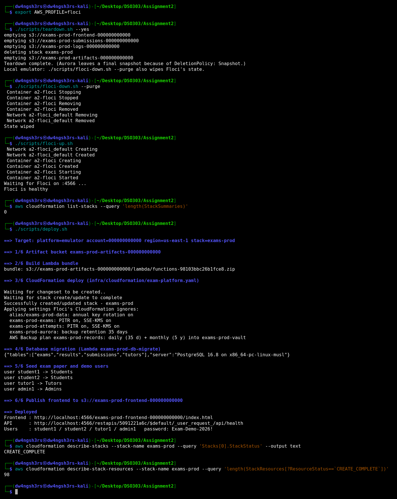

*Figure 4. Starting from an empty emulator, `./scripts/deploy.sh` builds the whole system from code. At the end the stack shows CREATE_COMPLETE with 98 resources.*

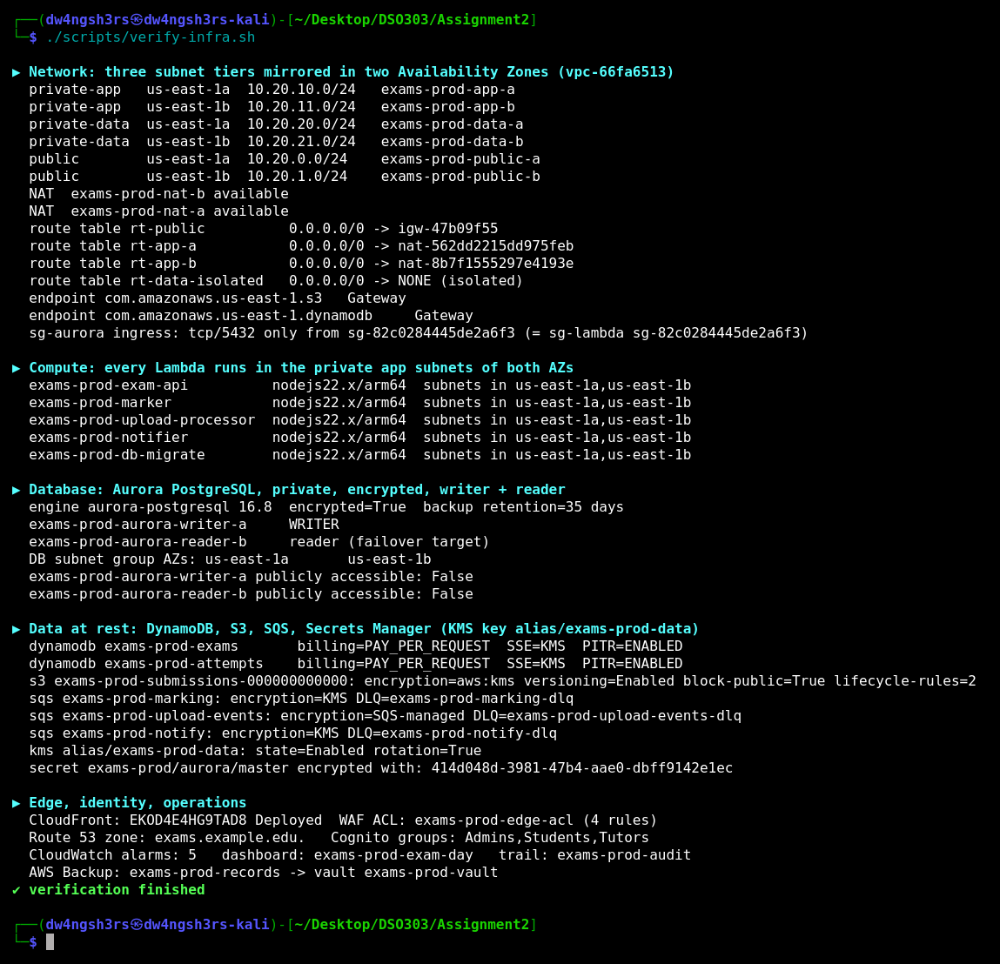

*Figure 5. `./scripts/verify-infra.sh` reads the deployed system back to check it: three subnet layers in both AZs, a NAT gateway in each AZ, a database that cannot be reached from the internet, Lambda in both AZs, and encryption, backups and logging all switched on.*

### 4.3 Walkthrough 1 – opening an exam and autosaving

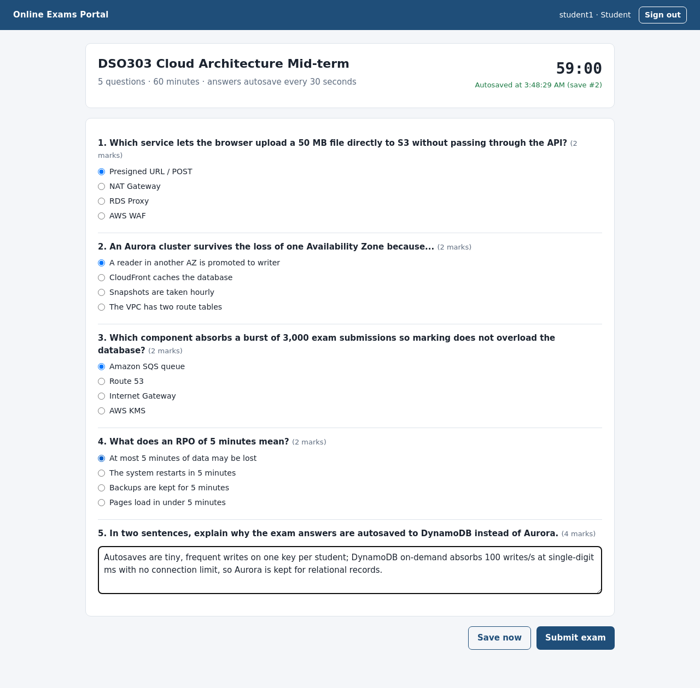

*Figure 6. The web app as a student. The exam is open, the timer is running, and the page shows "Autosaved at 3:48:29 AM (save #2)". The two saves happened 30 seconds apart, on the browser's own timer.*

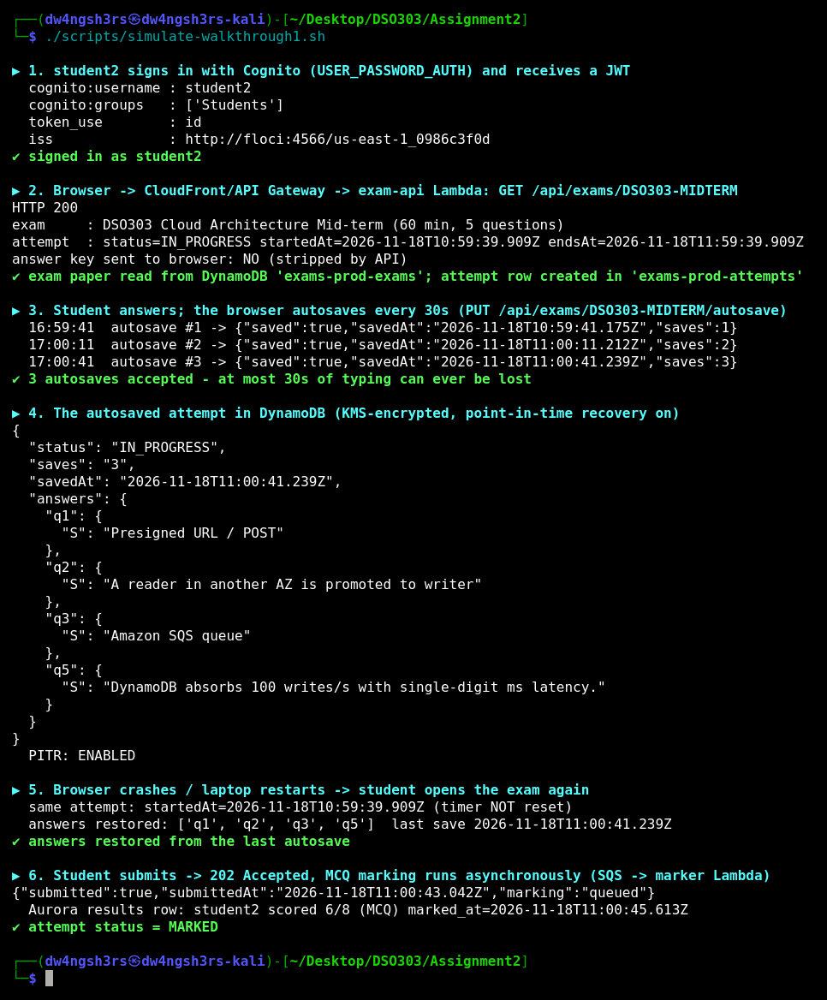

*Figure 7. What happens behind the scenes in Walkthrough 1: the student signs in, the answer key is not sent to the browser, three autosaves arrive 30 seconds apart, the answers are restored after a crash with the same timer, and the submitted exam is marked automatically.*

### 4.4 Walkthrough 2 – uploading 40 MB and notifying the tutor

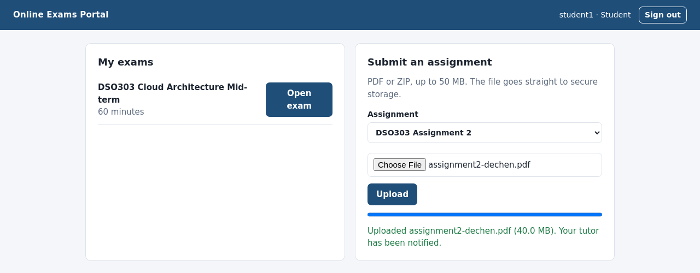

*Figure 8. The student uploads a 40 MB PDF in the web app. It goes straight to S3 in about 2 seconds.*

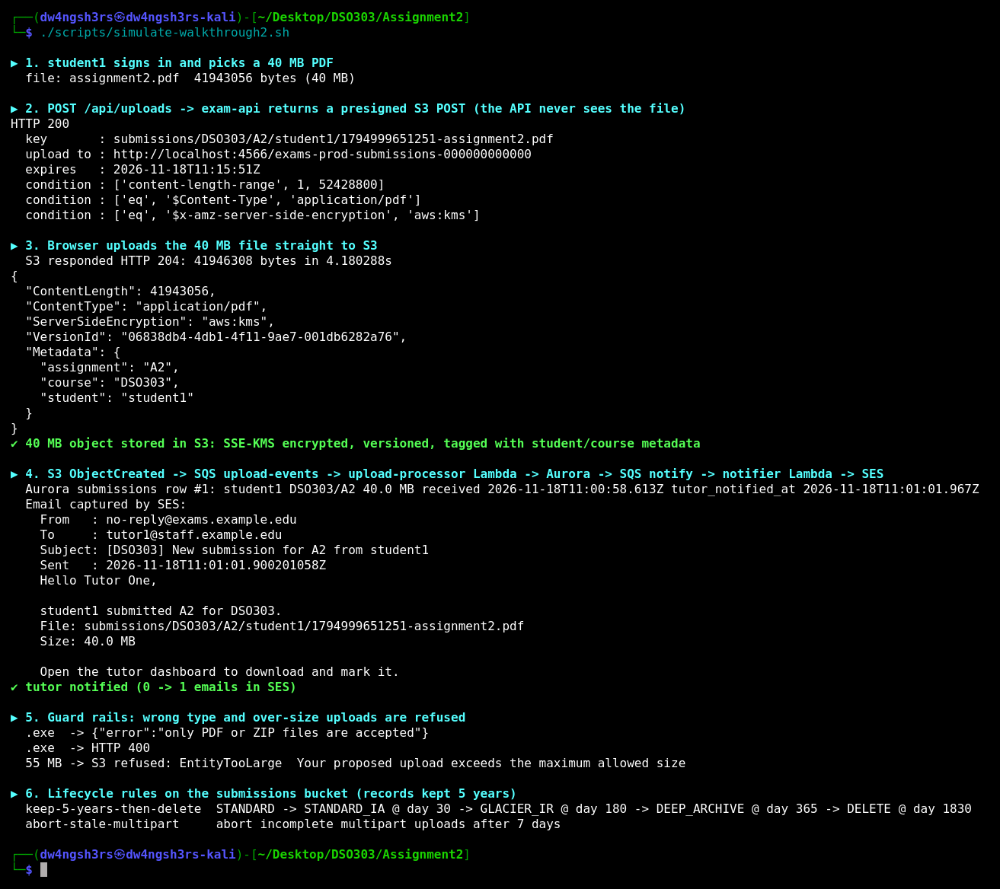

*Figure 9. What happens behind the scenes in Walkthrough 2: the upload link only allows files up to 50 MB, the file is stored encrypted in S3, the submission is saved in the database, and the tutor receives the email about 2 seconds later. A .exe file and a 55 MB file are both rejected.*

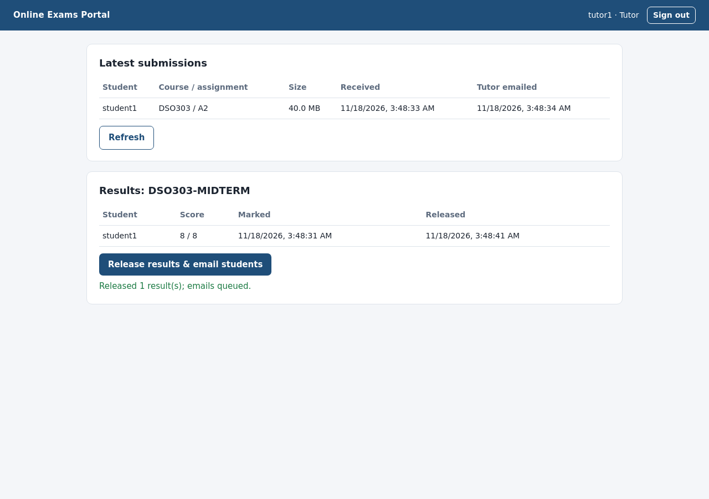

*Figure 10. The tutor's page: new submissions with the time the tutor was emailed, the automatically marked results, and the results being released to students.*

### 4.5 Losing one Availability Zone

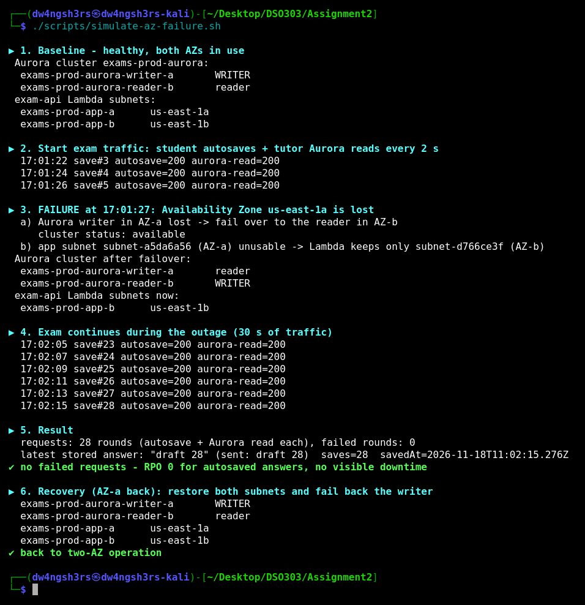

*Figure 11. AZ-a is switched off while a student keeps autosaving and a tutor keeps reading the database every 2 seconds. The database switches to its standby in AZ-b, and Lambda runs only in AZ-b. All 28 requests succeed and the last answer ("draft 28") is saved, so nothing is lost. Afterwards both AZs are restored.*

For real AWS, the same test is provided as an AWS Fault Injection Service template (`infra/fis/az-a-outage.json`). It switches the database to its standby, cuts AZ-a off for 10 minutes, and stops by itself if the API starts returning errors.

### 4.6 Infrastructure as code and CI/CD

The pipeline is defined in `.github/workflows/deploy.yml`. On every push to the `main` branch it runs three steps:

- **Check:** the CloudFormation template, all the code and all the scripts are checked for errors.
- **Deploy:** `deploy.sh` deploys the system, on the Floci machine or on real AWS.
- **Test:** `smoke-test.sh` checks that the main features work.

For real AWS, GitHub signs in to AWS with a short-lived role (OIDC), so no AWS passwords or keys are stored in GitHub.

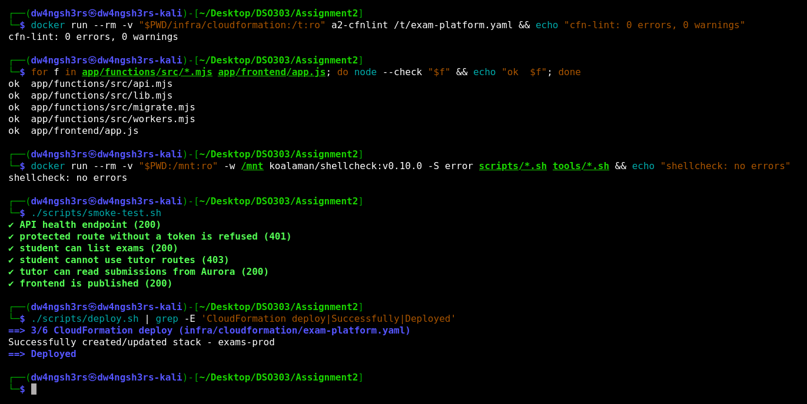

*Figure 12. The pipeline's checks run on this project: no template errors or warnings, all code compiles, the scripts are clean, all 6 smoke tests pass (including refusing a request without a token, and stopping a student from using tutor pages), and deploying again changes nothing.*

Removing the system is also done by code: `scripts/teardown.sh` empties the storage, deletes the stack and cleans up. It was used to start from an empty emulator before Figure 4.

### 4.7 Cloud Architecture Lab build

The same design was also built in the course's Cloud Architecture Lab. The lab files in `evidence/lab-json/` use the same names, subnets and permissions as the CloudFormation template. They were loaded with **Export → Upload JSON** and then simulated in the lab.

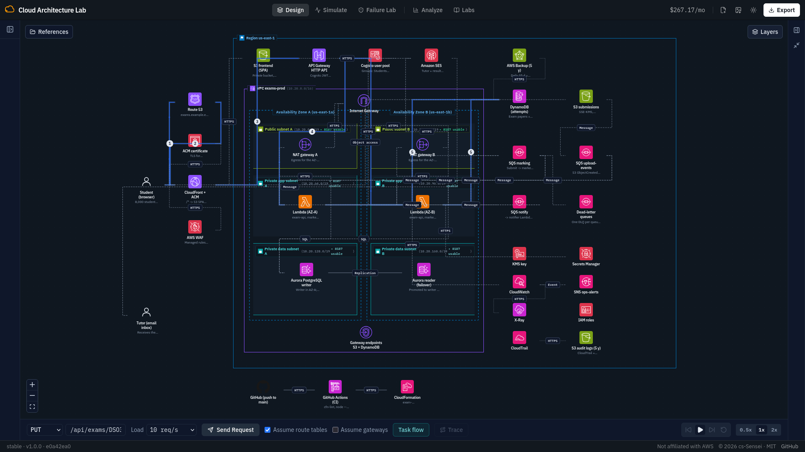

*Figure 13. The complete design in the Cloud Architecture Lab: the edge services, the VPC with AZ-A and AZ-B (each with a public, app and data subnet), the regional services, and the GitHub → GitHub Actions → CloudFormation pipeline.*

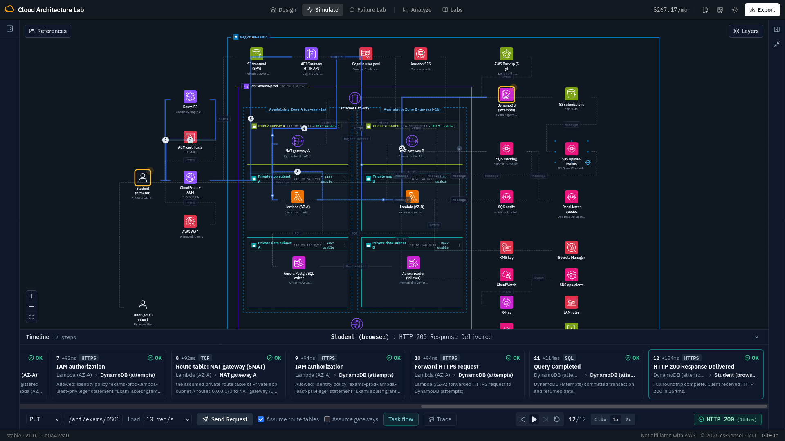

*Figure 14. Walkthrough 1 in the lab: Student → Route 53 → CloudFront → API Gateway → Lambda (AZ-A) → DynamoDB. The lab checks the Lambda's permissions and the result is HTTP 200 (success) in 154 ms.*

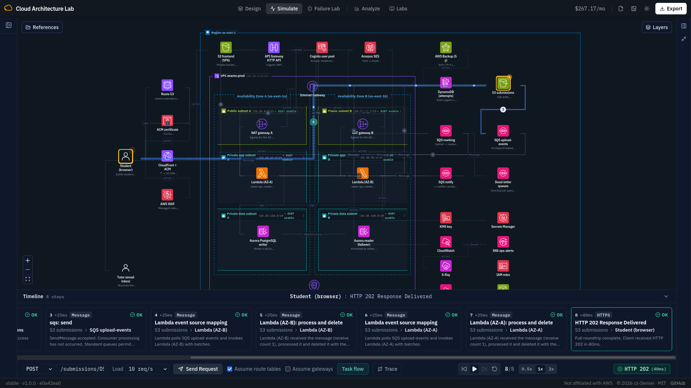

*Figure 15. Walkthrough 2, part 1: the file goes straight to S3 (the line only crosses the VPC on the drawing), S3 puts a message in the upload queue, and the upload-processor Lambda handles it. Result: HTTP 202 (accepted).*

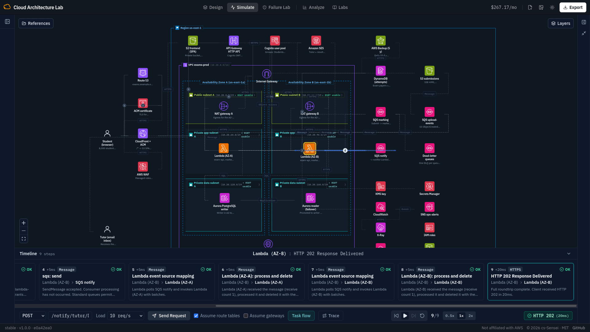

*Figure 16. Walkthrough 2, part 2: the upload-processor Lambda puts the tutor notification in the notify queue and the notifier Lambda handles it. The dashed lines show the email going through SES to the tutor. Result: HTTP 202 (accepted).*

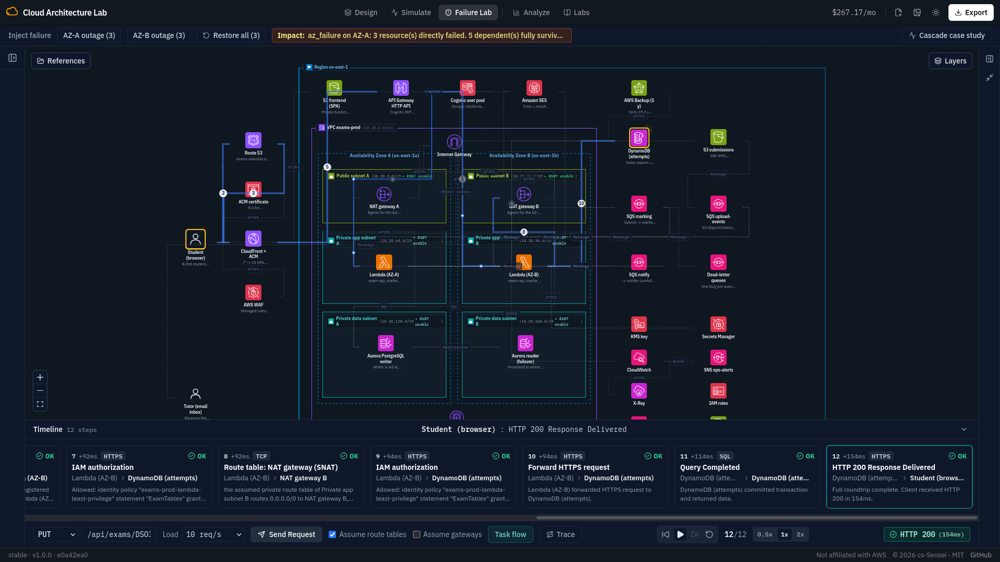

*Figure 17. AZ-A failure in the lab's Failure Lab: 3 parts in AZ-A fail (NAT gateway A, Lambda AZ-A and the Aurora writer), and the 5 parts that depend on them survive by switching to AZ-B. The autosave request still succeeds (HTTP 200).*

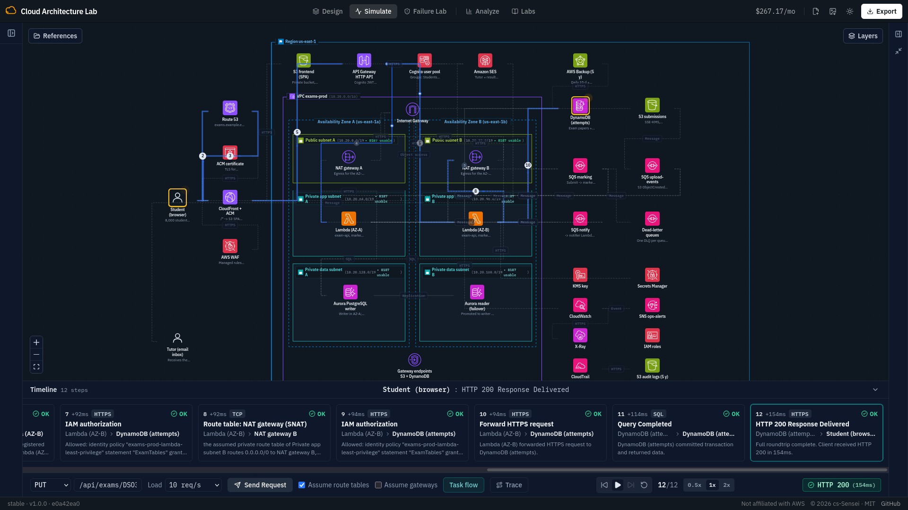

*Figure 18. The same request during the AZ-A failure: it now goes through Lambda (AZ-B) and NAT gateway B, and still succeeds (HTTP 200).*

Two differences between the lab and the CloudFormation template:

- The lab divides the VPC into equal subnets by itself, so the subnets appear as `/19` instead of `/24`. The layers and AZs are the same.
- In the lab, a request finishes once a queue message has been processed, just like on AWS. That is why Walkthrough 2 is shown in two parts. The lab cannot run Amazon SES yet, so the email line is drawn but not simulated. The real email is shown in Figure 9.

---

## 5. Requirements traceability

This table connects each requirement to the part of the design that meets it and the figure that proves it.

| Requirement | How the design meets it | Evidence |
|---|---|---|
| VPC with public and private subnets in two AZs | 6 subnets in 3 layers, built in both AZs; a NAT gateway in each AZ; the data layer has no internet access | Figures 1, 5, 13 |
| Edge: DNS, CDN, WAF | Route 53 → CloudFront (with HTTPS) + WAF | Figures 1, 5 |
| Sign-in based on role | Cognito groups; the token is checked on every request; wrong role refused | Figures 7, 12 |
| Timed exam with autosave every 30 seconds | The server sets the end time; answers saved in DynamoDB | Figures 6, 7 |
| Automatic marking of MCQs | Marking queue → marker Lambda → Aurora | Figures 7, 10 |
| Uploads up to 50 MB (PDF/ZIP) | Presigned upload link that enforces size, type and encryption | Figures 8, 9 |
| Emails for results and new uploads | Notify queue → notifier Lambda → SES | Figures 9, 10 |
| Database in two AZs | Aurora writer in AZ-a, standby in AZ-b, automatic switch-over | Figures 5, 11 |
| Survive the loss of one AZ | Every layer exists in both AZs; regional services | Figures 11, 17, 18 |
| Lose at most 5 minutes; recover within 1 hour | Autosaves stored in several AZs; point-in-time backups; switch-over under a minute | Figures 7, 11 |
| Keep records for 5 years | S3 deletes after 5 years; AWS Backup keeps monthly copies for 5 years | Figures 5, 9 |
| Encryption when sent and when stored | HTTPS everywhere; KMS encryption for all stored data | Figures 5, 9 |
| Monitoring and secrets | CloudWatch alarms and dashboard, X-Ray, Secrets Manager | Figure 5 |
| Infrastructure as code; push to main redeploys | CloudFormation + GitHub Actions | Figures 4, 12 |
| Cloud Architecture Lab build, both walkthroughs, AZ failure | Lab files made from the same design | Figures 13–18 |

---

## 6. Conclusion

The design meets all the requirements in the brief using managed AWS services that work across more than one AZ:

- **Exam rush:** Lambda and DynamoDB handle the 3,000-student start, and queues absorb the bursts.
- **Large uploads:** files go straight to S3 and never pass through the API.
- **Availability:** every network layer exists in both AZs, and the database switches over automatically.
- **Records and security:** 5-year retention and encryption are enforced by settings, not by people remembering.

The system deploys from code in about a minute on the emulator, passes all checks and tests, and was shown working for both walkthroughs and for the loss of an AZ.

---

## References

1. Amazon Web Services (2024) *AWS Well-Architected Framework – Reliability Pillar*. https://docs.aws.amazon.com/wellarchitected/latest/reliability-pillar/
2. Amazon Web Services (2024) *Amazon Aurora high availability and failover*. https://docs.aws.amazon.com/AmazonRDS/latest/AuroraUserGuide/Concepts.AuroraHighAvailability.html
3. Amazon Web Services (2024) *Uploading objects with presigned URLs*. https://docs.aws.amazon.com/AmazonS3/latest/userguide/PresignedUrlUploadObject.html
4. Amazon Web Services (2024) *Controlling access to HTTP APIs with JWT authorizers*. https://docs.aws.amazon.com/apigateway/latest/developerguide/http-api-jwt-authorizer.html
5. Amazon Web Services (2024) *Using AWS Lambda with Amazon SQS*. https://docs.aws.amazon.com/lambda/latest/dg/with-sqs.html
6. Amazon Web Services (2024) *Managing your storage lifecycle (S3)*. https://docs.aws.amazon.com/AmazonS3/latest/userguide/object-lifecycle-mgmt.html
7. Floci (2026) *Floci – local AWS emulator documentation*. https://floci.io
